# Hi3516CV610_SDK_V1.0.2.1_MPP_Sample

### 背景：

​	为降低代码维护复杂度，将Hi3516CV610 SDK中的MPP Sample代码提取出来，单独进行维护，既方便及时更新相关代码，也方便集成代码到客户工程。

​	如果使用过程中遇到问题，欢迎到易百纳技术社区(https://www.ebaina.com/)发帖提问，并将帖子链接提交到Issue中，我们会尽快安排技术人员处理。

### 1.为减少代码仓大小，已将相关测试源文件删除，可从SDK中获取。

SDK目录：
```
SDK对应目录Hi3516CV610_SDK_V1.0.2.1/smp/a7_linux/source/mpp/sample
```
涉及删除的文件和目录：

```
src/bla/data目录
src/region/res目录
src/scene_auto/param目录
src/spi_lcd/input.h265文件
src/svc_venc/svp_svc/data目录
src/svp/ive/data目录
src/svp/svp_npu/data目录
src/vgs/res目录
src/vie/UsePic_2560x1440_sp420.yuv文件
```
### 2. Sample 说明

#### 1). 编译Sample

##### ①. 编译所有Sample

​	进入`src`目录下直接`make`，编译所有的`sample`。也可以进入具体的`sample`目录，编译单独的`sample`。

##### ②. 编译带sensor的sample

	对于需要使用到Sensor的例程，需要修改src/Makefile.param。

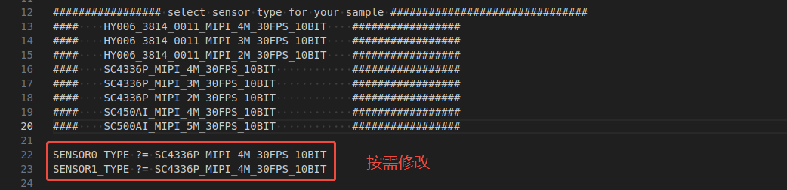

#### 2). audio 说明

##### ①. 编译说明

```shell
src/audio下执行make, 生成sample_audio。
```

##### ②. 使用说明

```shell
1. 拷贝sample_audio至板端。
2. 连接麦克风和扬声器。
3. 运行./sample_audio 1, 录制语音，录音结果保存为 audio_chn0.aac 文件。其中,耳机麦克风作为左声道输入，板载 MIC 作为右声道输入。
4. 运行./sample_audio 2, 播放audio_chn0.aac文件。
```

a.音频输入

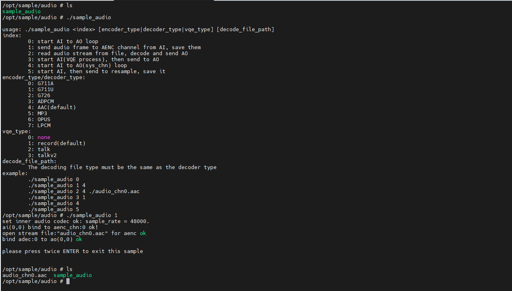

b.音频输出

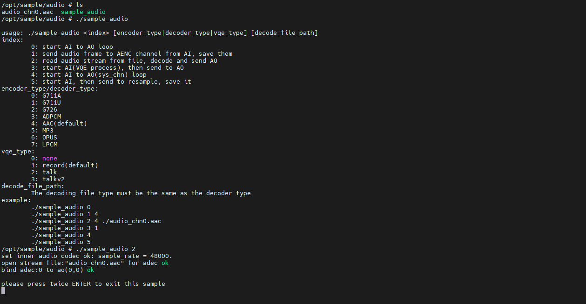

#### 3). uvc 说明

##### ①. 编译说明

```shell
1.编译Sample前，可根据实际使用的Sensor类型修改src/Makefile.param中的相关配置。若不修改，则默认使用src/Makefile.param中配置的Sensor类型;程序运行时也支持通过参数动态指定Sensor类型。
2.src/uvc下执行make, 生成sample_uvc和sample_uvc_v412。
```

##### ②. 使用说明

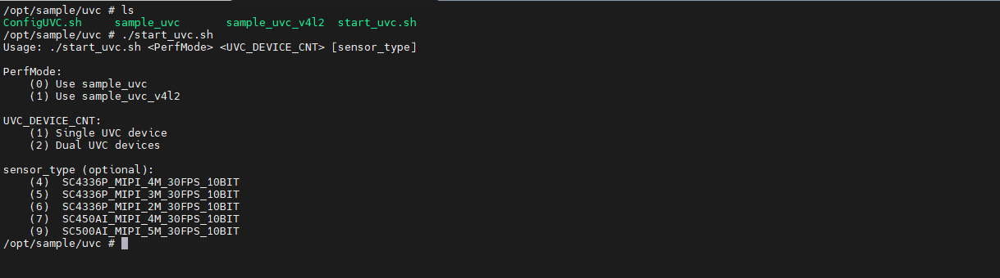

```shell
./start_uvc.sh 0 1 6    #单路UVC
./start_uvc.sh 1 1 6    #单路UVC(v4l2框架)
```

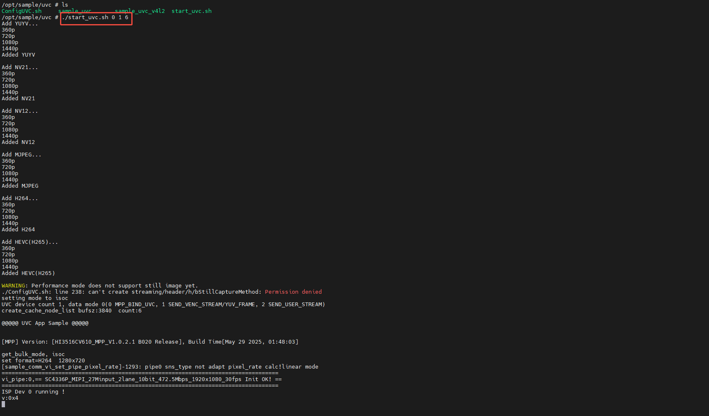

#### 4). rtspserver 说明

​	此目录代码基于 [PHZ76/RtspServer 项目]([PHZ76/RtspServer: RTSP Server , RTSP Pusher](https://github.com/PHZ76/RtspServer))

##### ①. 编译说明

```shell
1.src/rtspserver下执行make, 生成libxoprtsp.a。
```

##### ②. 使用说明

```shell
1.拷贝api调用头文件至include/3rdparty下。
2.拷贝libxoprtsp.a库至lib/3rdparty。
```


#### 5). venc 说明

##### ①. 编译说明

```shell
1.编译Sample前，可根据实际使用的Sensor类型修改src/Makefile.param中的相关配置。若不修改，则默认使用src/Makefile.param中配置的Sensor类型;程序运行时也支持通过参数动态指定Sensor类型。
2.src/venc下执行make, 生成sample_venc。
```

##### ②. 使用说明

a.录像测试

```shell
1.拷贝sample_venc至板端。
2.运行sample_venc 0 0 6后，等待2~4秒，连按两次回车退出程序，查看当前目录是否生成 stream_chn0.h265、stream_chn1.h264 文件。
```

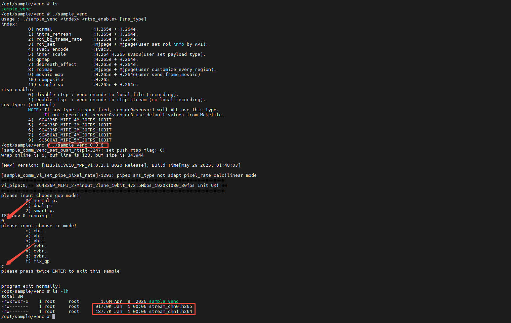

b.rtsp拉流测试

```shell
1.拷贝sample_venc至板端。
2.运行sample_venc 0 1 6后，使用VLC/PotPlayer等拉流软件进行拉流(拉流地址：rtsp://<板卡IP>:554/live0)。
```

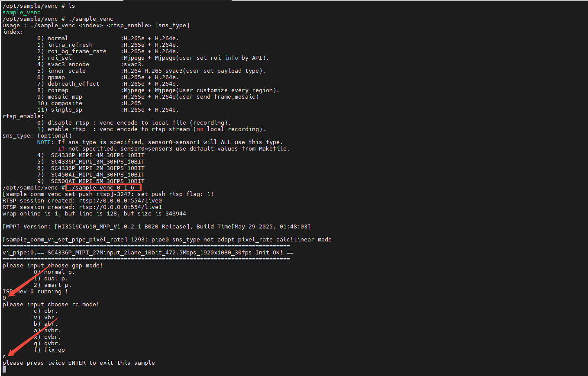

#### 6). aiisp 说明

##### ①. 编译说明

```shell
1.编译Sample前，可根据实际使用的Sensor类型修改src/Makefile.param中的相关配置。若不修改，则默认使用src/Makefile.param中配置的Sensor类型;程序运行时也支持通过参数动态指定Sensor类型。
2.src/aiisp下执行make, 生成sample_aiisp。
```

##### ②. 使用说明

a.录像测试

```shell
1.拷贝sample_aiisp至板端。
2.SDK中获取mpp/sample/aiisp下的aibnr对应的模型文件。
3.运行sample_aiisp 0 0 4后，等待2~4秒，连按两次回车退出程序，查看当前目录是否生成 stream_chn0.h265文件。
```

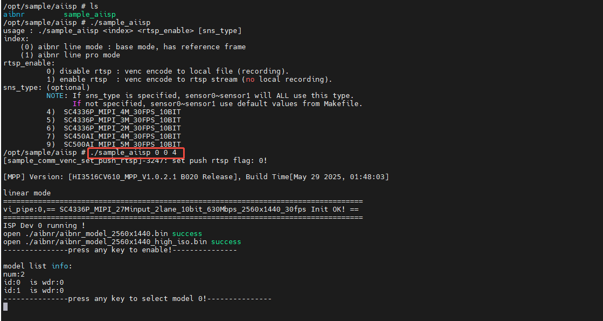

b.rtsp拉流测试

```shell
1.拷贝sample_aiisp至板端。
2.SDK中获取mpp/sample/aiisp下的ai3dnr、aibnr、aidrc对应的模型文件。
3.运行sample_aiisp 0 1 0 4后，使用VLC/PotPlayer等拉流软件进行拉流(拉流地址：rtsp://<板卡IP>:554/live0)。
```

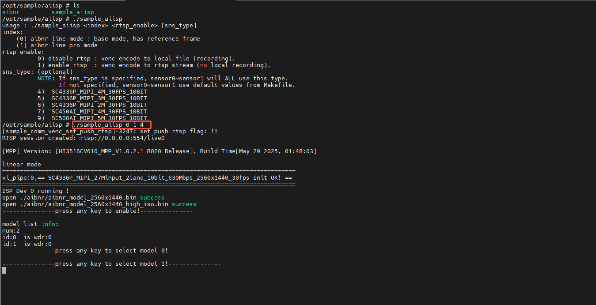


#### 7). svp 说明

##### ①. 编译说明

```shell
1.编译Sample前，可根据实际使用的Sensor类型修改src/Makefile.param中的相关配置。若不修改，则默认使用src/Makefile.param中配置的Sensor类型;程序运行时也支持通过参数动态指定Sensor类型。
2.src/svp/svp_npu下执行make, 生成sample_svp_npu_main。
```

##### ②. 使用说明

```shell
1.拷贝生成sample_svp_npu_main至板端。
2.SDK中获取mpp/sample/svp/svp_npu/data下依赖文件。
3.运行sample_aiisp a 8 1 4后，使用VLC/PotPlayer等拉流软件进行拉流(拉流地址：rtsp://<板卡IP>:554/live0)。
```

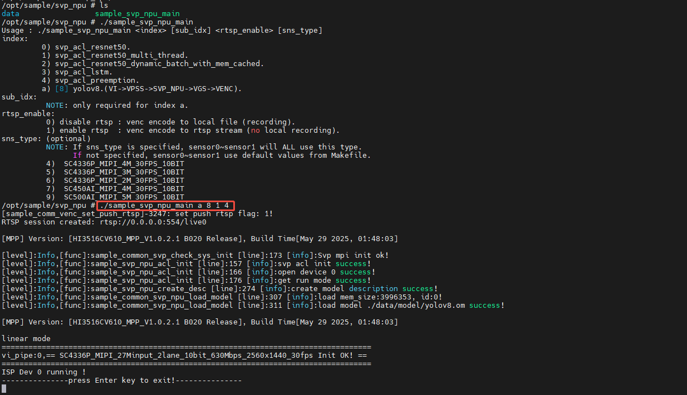

#### 8). aidetect 说明

##### ①. 编译说明

```shell
1.编译Sample前，可根据实际使用的Sensor类型修改src/Makefile.param中的相关配置。若不修改，则默认使用src/Makefile.param中配置的Sensor类型;程序运行时也支持通过参数动态指定Sensor类型。
2.src/svp/ai_component/aidetect下执行make, 生成sample_aidetect。
3.src/svp/ai_component/aidetect_vie下执行make, 生成sample_aidetect_vie。
```

##### ②. 使用说明

```shell
1.拷贝生成sample_aidetect和sample_aidetect_vie至板端。
2.SDK中获取model、date等依赖文件。
```

a.aidetect

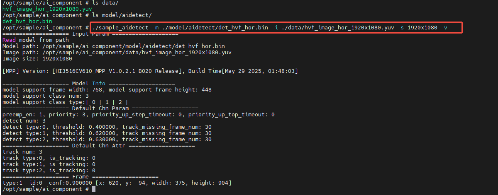

b.aidetect_vie

使用VLC/PotPlayer等拉流软件进行拉流(拉流地址：rtsp://<板卡IP>:554/live1)。

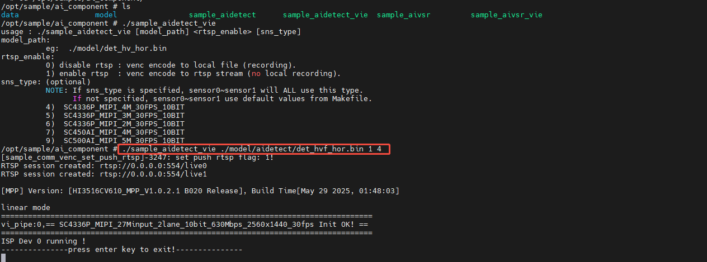

#### 9).aivsr说明

##### ①. 编译说明

```shell
1.编译Sample前，可根据实际使用的Sensor类型修改src/Makefile.param中的相关配置。若不修改，则默认使用src/Makefile.param中配置的Sensor类型;程序运行时也支持通过参数动态指定Sensor类型。
2.src/svp/ai_component/aivsr下执行make, 生成sample_aivsr。
3.src/svp/ai_component/aivsr_vie下执行make, 生成sample_aivsr_vie。
```

##### ②. 使用说明

```shell
1.拷贝生成sample_aivsr和sample_aivsr至板端。
2.SDK中获取model、date等依赖文件。
```

a.sample_aivsr

>  测试人脸底库特征提取和人脸特征与底库比对

准备两张不同的人脸图片，转成NV21格式的YUV文件，先选择一张图片生成 .txt 的特征文件。

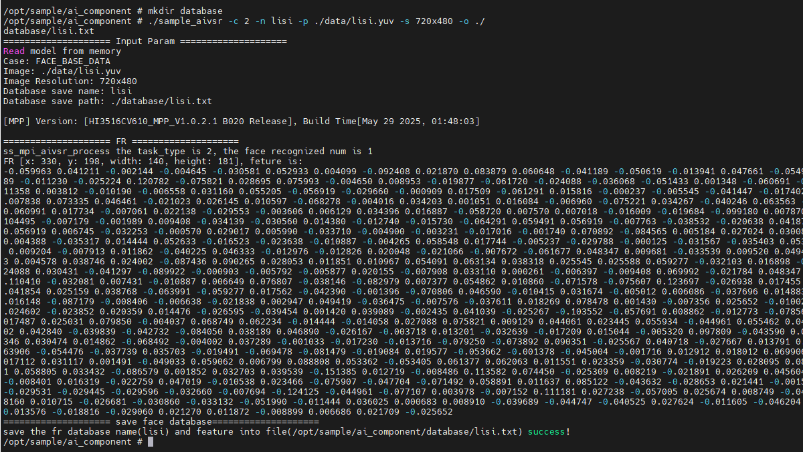

再用另一张图片进行比对

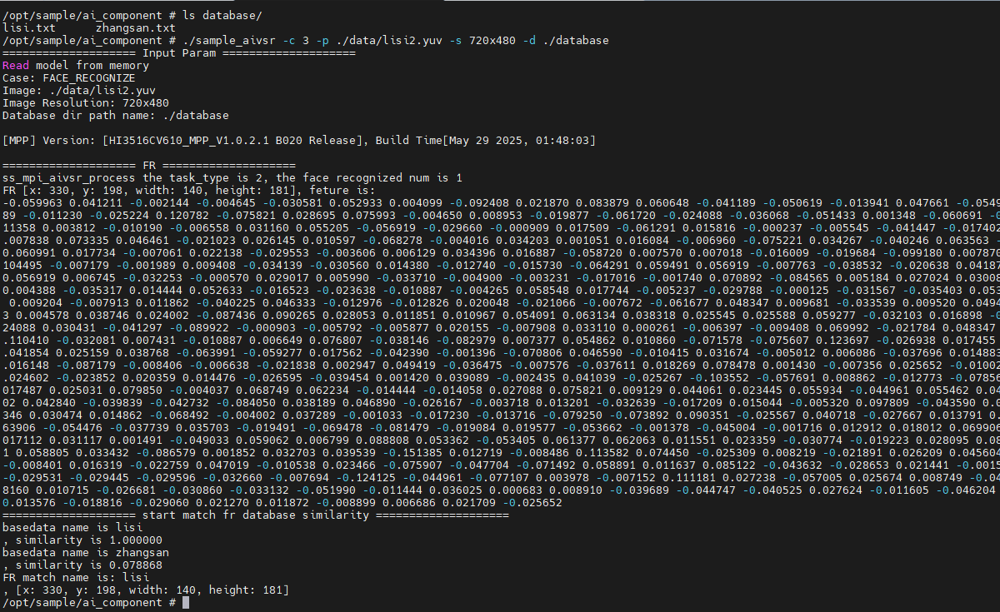

b.sample_aivsr_vie

使用VLC/PotPlayer等拉流软件进行拉流(拉流地址：rtsp://<板卡IP>:554/live1)。

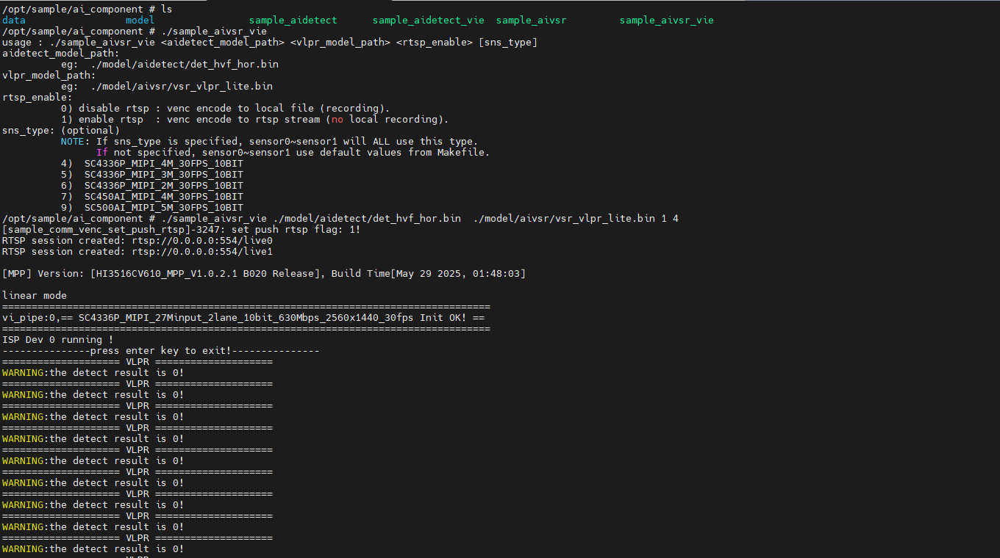

#### 10).kol说明

##### ①. 编译说明

```shell
1.编译Sample前，可根据实际使用的Sensor类型修改src/Makefile.param中的相关配置，仅支持SC4336P。
2.src/kol下执行make, 生成sample_kol。
```

②. 使用说明

```shell
1.需要使用kol版本固件，并准备FAT32文件系统的SD卡。
2.拷贝生成sample_kol至板端。
3.SDK中获取model、param等依赖文件。
```

a.浅睡眠模式

未检测到目标进入单帧模式，若检测到目标进入录制模式（30帧/s）并抓拍生成stream_chn1_xxx.jpg图片，图片存放在TF卡中

```shell
./sample_kol -n 1 -k 0 -s 1 -r 1 -i ./param/sensor_sc4336p
```

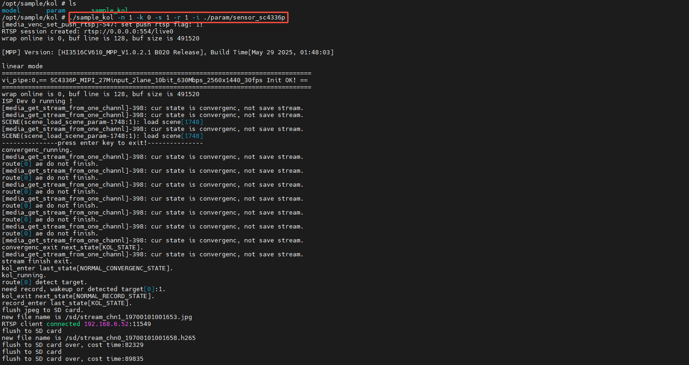

②.深睡眠模式

未检测到目标进入单帧模式，若检测到目标进入录制模式（30帧/s）并抓拍生成stream_chn1_xxx.jpg图片，图片存放在TF卡中，单帧模式下不支持网络，进入录制模式后支持网络，需在调试串口终端中验证例程。

```shell
./sample_kol -n 1 -k 0 -s 2 -r 1 -i ./param/sensor_sc4336p
```

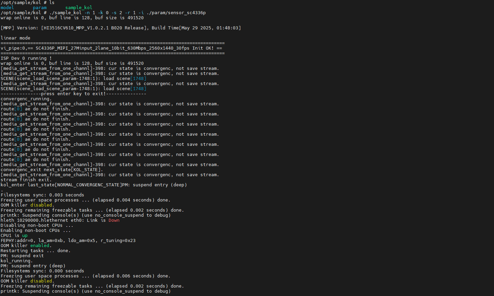

程序执行时自动挂载 SD 卡，若程序执行结束后无自动挂载，可手动挂载查看图片

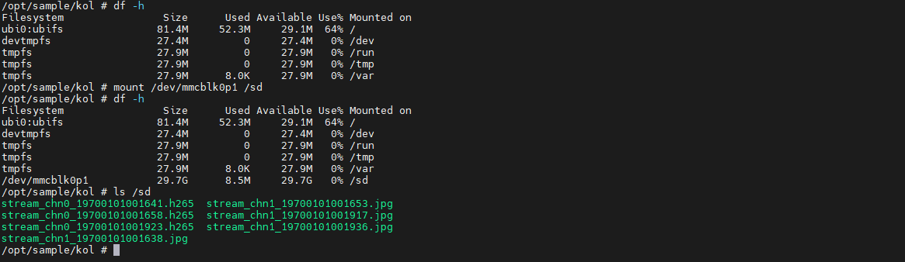
